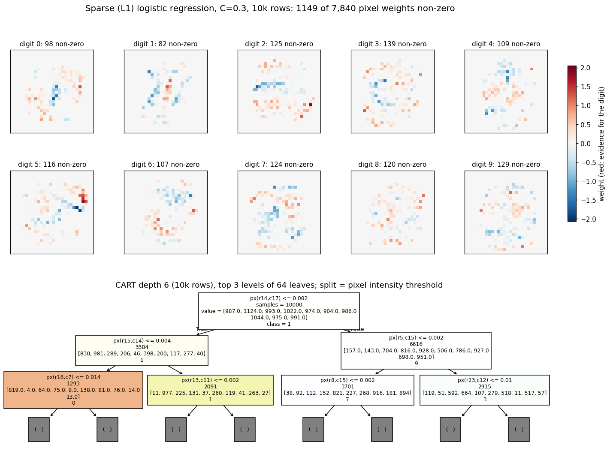

# Interpretable baselines for the ExConNEAT MNIST 10-class network

## In plain language

On exactly the rows the ExConNEAT run uses, the standard interpretable models land as follows (validation accuracy,
10k training rows):

* **A tree you can actually read** (depth 4 to 8, 16 to 225 leaves) gets 0.63 to 0.80. The best tree of any depth
  gets 0.81, but it has 780 leaves and nobody reads it.
* **Linear models** (one weight map per digit) get 0.91. Making them sparse (L1) keeps 0.91 while switching off
  85% of the 7,850 weights, leaving 1,159 non-zero, still about 115 pixel weights per digit.
* **An EBM** (one learned shape function per pixel, per digit, added up) gets 0.93, but those are 784 pixel
  functions with about 109,000 bins in total.
* **Gradient boosting** (1,000 trees, about 30,600 leaves, not interpretable) gets 0.96: the strong reference.

So the ExConNEAT network (about 0.95 validation with about 1,000 parameters, every part inspectable; see `../RESULTS.md`)
sits above every interpretable comparator here and close to the non-interpretable one, with about as many
parameters as the sparse linear model has non-zero weights. On all 50,000 training rows most models gain 1 to 2
points and the best unreadable tree 6; the depth-4 tree loses 4 (its greedy top splits change). The ordering of the
model families stays the same.

## Results

Validation = the run's 10,000 rows; test = the standard 10,000, read once per final model. "10k" = the run's
10,000-row training subset; "50k" = the full training pool. Every setting was chosen on validation only.

| Model | Train rows | Val acc | Test acc | Size | What its explanation looks like |
|---|---|---|---|---|---|
| Sparse LR (L1, saga), C = 0.3 | 10k | 0.912 | 0.911 | 1,149 non-zero pixel weights (+10 intercepts) of 7,850; 414 pixels used | one sparse weight map per digit (about 115 pixels each) |
| Sparse LR (L1, saga), C = 1.0 | 50k | 0.925 | 0.924 | 3,242 non-zero (+10) of 7,850; 575 pixels used | one sparse weight map per digit (about 325 pixels each) |
| Plain LR (L2, lbfgs), C = 0.3 | 10k | 0.916 | 0.913 | 7,850 parameters | one dense weight map per digit |
| Plain LR (L2, lbfgs), C = 0.3 | 50k | 0.926 | 0.925 | 7,850 | one dense weight map per digit |
| CART depth 4 (readable) | 10k | 0.630 | 0.643 | 16 leaves | a tree of pixel thresholds, 16 leaves |
| CART depth 4 (readable) | 50k | 0.591 | 0.596 | 16 leaves | a tree of pixel thresholds, 16 leaves |
| CART depth 6 (readable) | 10k | 0.727 | 0.733 | 64 leaves | a tree of pixel thresholds, 64 leaves |
| CART depth 6 (readable) | 50k | 0.732 | 0.741 | 64 leaves | a tree of pixel thresholds, 64 leaves |
| CART depth 8 (readable) | 10k | 0.800 | 0.811 | 225 leaves | a tree of pixel thresholds, 225 leaves |
| CART depth 8 (readable) | 50k | 0.813 | 0.816 | 252 leaves | a tree of pixel thresholds, 252 leaves |
| CART best depth (12), not readable | 10k | 0.812 | 0.824 | 780 leaves | a tree of pixel thresholds, 780 leaves |
| CART best depth (16), not readable | 50k | 0.874 | 0.879 | 2,926 leaves | a tree of pixel thresholds, 2,926 leaves |
| EBM (784 pixels, no interactions) | 10k | 0.926 | 0.924 | 784 shape functions (675 non-zero), 109,075 bins x 10 classes | per pixel, a step function of intensity for each digit; the logits add them up |
| EBM (784 pixels, no interactions) | 50k | 0.941 | 0.940 | 784 shape functions (717 non-zero), 126,483 bins x 10 classes | as above |
| HistGradientBoosting (defaults), not interpretable | 10k | 0.963 | 0.963 | 100 rounds x 10 classes = 1,000 trees, 30,605 leaves | none readable: 1,000 trees summed |
| HistGradientBoosting (defaults), not interpretable | 50k | 0.976 | 0.977 | 1,000 trees, 31,000 leaves | none readable |

The ExConNEAT reference: about 0.95 validation with about 1,000 parameters on the 10k subset (the headline network
and its test figure are in `../RESULTS.md`).

*Top: the sparse (L1, C = 0.3, 10k rows) logistic regression's weight map per digit; red pixels add evidence for
the digit, blue against, grey is exactly zero. Bottom: the readable depth-6 tree (10k rows), first three levels of
its 64 leaves; each split is one pixel's intensity (row r, column c) against a threshold.*

## Checks against the earlier figures

* Plain LR with sklearn defaults (C = 1) gets **0.909** validation on the 10k rows, reproducing the earlier 0.910.
  Tuning C on validation picks 0.3 (0.916).
* HistGradientBoosting with defaults gets **0.963** validation on the 10k rows, reproducing the earlier 0.963.

## Setup and caveats

* **Data**: `explaneat.conv.data.mnist_splits(seed=0, classes=0..9, n_train=10000 or None, n_val=10000)`, the
  function `run_long.py` calls, on the cached `~/.explaneat/data/mnist_784.npz`. Validation is the same 10,000 rows
  for both training pools. Pixels / 255, flattened to 784 features. No other preprocessing.
* **Tuning**: L1 and L2 LR: C in {0.01, 0.03, 0.1, 0.3, 1}. Trees: max_depth 4, 6, ..., 30 and unlimited; the best is the
  shallowest depth with the highest validation accuracy. EBM: two configurations (below). HGB: none (defaults).
  The full tuning curves are in `results.json`.
* **Sparse LR at 50k** picked C = 1.0, the top of the grid (0.925 vs 0.924 at C = 0.3, with 2,146 non-zero), and saga
  stopped at its 300-iteration cap for C = 0.3 and 1.0 (tol 1e-3) on both pools. A larger C or more iterations might
  add a few tenths of a point and many more non-zeros; the sparse model's point is the 10k row, where C = 0.3 and C = 1
  are within 0.001.
* **EBM**: `interpret-core` 0.7.8 (the `interpret` package's core, which holds `ExplainableBoostingClassifier`;
  the full `interpret` meta-package only adds dashboard dependencies), installed into this worktree's `.venv` only
  with `uv pip install interpret-core`; `pyproject.toml` is unchanged, so a `uv sync` removes it. Multiclass EBM was
  fast enough on all 784 pixels, so there was **no downsampling and no one-vs-rest**: one native multiclass EBM,
  `interactions=0` (main effects only: one shape function per pixel, each giving 10 class scores), `outer_bags=8`,
  `n_jobs=2`, `random_state=0`, other settings default. Tuned: learning rate default vs 0.03 on the 10k rows
  (0.926 vs 0.924); the default was kept and refit on 50k. Wall time: 4.5 min (10k) and 25 min (50k) on 2 CPU
  threads, inside the 45-minute cap.
* **HGB at 50k**: with more than 10,000 rows, sklearn's default `early_stopping="auto"` switches on and holds out
  10% of the training rows internally; it still ran all 100 rounds. At 10k it is off.
* CPU only, at most 2 processes of 2 threads, alongside the MPS run.
* The CART, LR and EBM models are deterministic given `random_state=0`; no seed variance is reported.

## Files

* `run_baselines.py`: the experiment (`--part lr|l1|tree|hgb|ebm --pool 10k|50k`); `run_all.sh` runs everything.
* `figure.py` -> `baselines_figure.png`.
* `results.json`: every number above, with tuning curves.
* `logs/`: run logs. The fitted models (`models/`, 186 MB of pickles) are not committed; `run_all.sh` rebuilds them
  in about 45 minutes.
