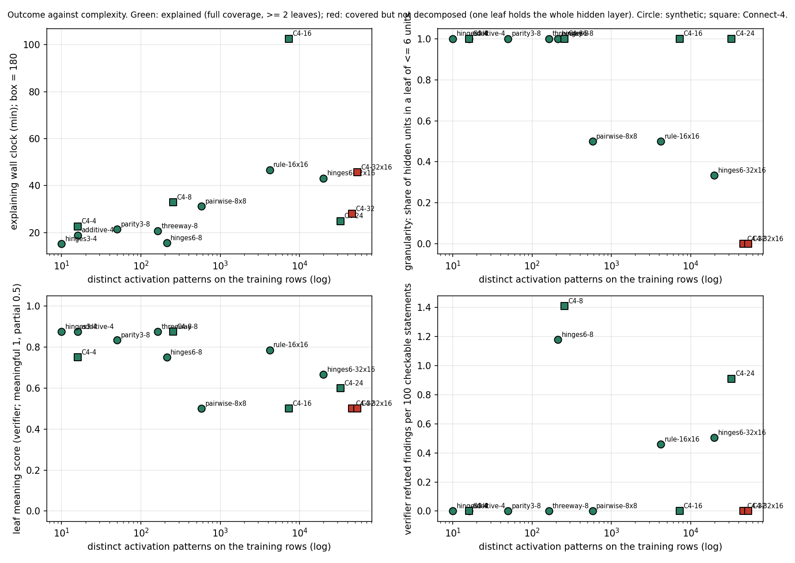
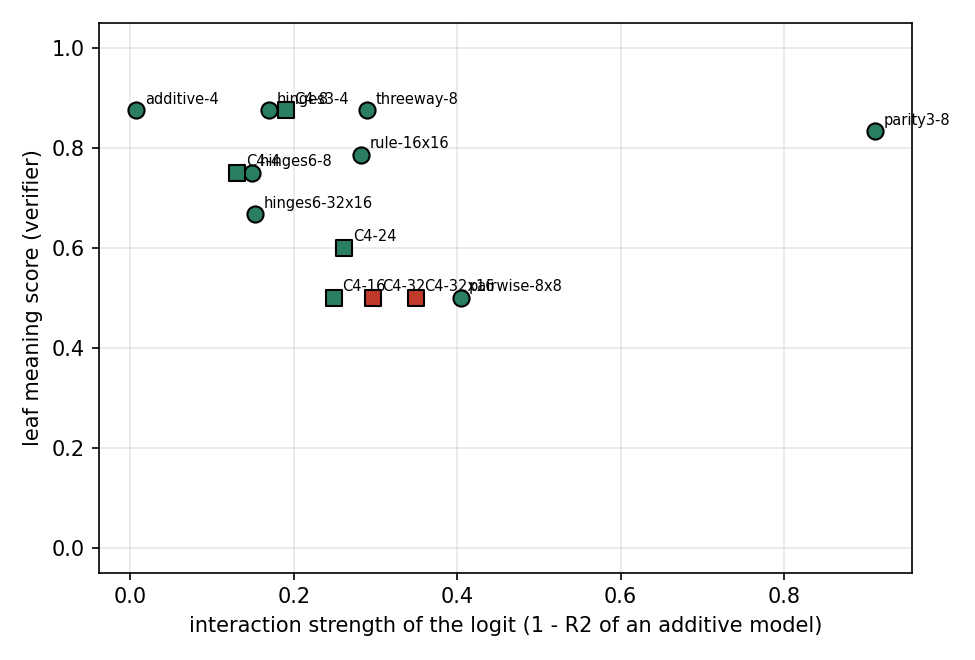

# Explanation complexity ladder: where does explanation break?

**Exploratory, not pre-registered.** Run 2026-11-11/12 on branch `exp/explanation-barrier`
(based on `origin/main` at `0fcd63a`).

PropNEAT has so far given us only simple networks to explain: linear on Connect-4 and MNIST, and a
geometric half-rule on KRK (`experiments/complex_real/README.md`). That measured the *learning*
barrier. This study bypasses the search. It explains plain backprop MLPs of known, increasing
complexity with the frozen methodology, to find the *explanation* barrier.

## Answer in brief

- **The function's complexity did not break the method.** Every synthetic network was explained
  with full coverage, inside the box, and recovered its ground truth at the root (15 to 47 min),
  including:
  - 3-bit parity, with interaction strength 0.91 (an additive model of the logit explains 9% of
    its variance);
  - a rule with two exceptions;
  - a 3-way interaction.
- **It broke on width.** It failed at a dense first layer wider than 26 units (Connect-4, 32 and
  32x16 hidden units).
  - **Coverage still passed:** structural and compositional coverage were 1.0 and the function was
    preserved.
  - **The cause:** `split_node` cannot copy a node into more than 26 pieces ("ran out of
    letters"). An input that feeds 32 units therefore cannot be split, and the whole first layer
    must sit in **one leaf** ("covered, not decomposed").
  - **This is a tool limit, not a conceptual one.** It holds at Connect-4 width 24 (5 leaves,
    25 min) and fails at width 32.
  - **The size control shows the same mechanism.** hinges6 at 32x16 (a simple known function, the
    same 32-wide first layer) was decomposed at its second layer only: its 32 first-layer units
    stay "described, not explained".
- **Below the hard break, meaning degrades smoothly with size and depth, not with interaction
  order.** The verifier's leaf meaning score fell from 0.75-0.88 (4-8 units) to 0.50-0.67 (16+
  units or two layers).
  - Spearman rho with activation patterns is -0.77, with parameters -0.74, and with interaction
    strength only -0.37.
  - **Depth is its own barrier.** In every 2-layer network, one layer never got a reading of its
    own: granularity was 0.33-0.50.
- **Accuracy held.** Verifiers refuted 7 findings in 2,274 checkable statements (0.31 per 100)
  and weakened 52 (2.3 per 100). Errors did not grow with complexity: the refuted findings are
  spread across small and large networks.
- **Plain-MLP Connect-4 test AUCs:** 0.885 (width 4), 0.900 (8), 0.921 (16), 0.930 (24),
  0.936 (32) and 0.942 (32x16). The baselines are LR 0.861, GBM 0.944 and PropNEAT 0.862. A
  32x16 MLP closes 97% of the gap from LR to GBM.

## Design

### Networks (`data.py`, `train.py`, `import_mlp.py`)

All networks are plain dense ReLU MLPs with a sigmoid output.
- **Training:** PyTorch, float64; Adam with lr 1e-2 (decayed), minibatch 512, BCE, weight decay
  1e-5. Early stopping uses a 10% slice of the training rows (patience 25). Seed 0.
- **Import:** each MLP becomes a NEAT genome: inputs -1..-d, hidden 1..H (ReLU), output 0
  (sigmoid). The genome is imported into Postgres `explaneat_dev` as experiment `ladder-<label>`.
- **Labels:** opaque (`lad-<5 hex>`), so the explaining agent never sees the generating function.
- **Parity check:** the genome as the MCP tools load it (StructureNetwork) and NeuralNeat were
  compared with the PyTorch model on every train and test row. The maximum difference is
  **≤ 4.4e-15** in all 17 imports (`logs/<label>.import.json`).

**Synthetic family: known ground truth.**
- **Inputs:** 30,000 rows (24,000 training, stratified 80:20, seed 42), with 10 tabular-like
  inputs:
  - age (normal, integer);
  - income (lognormal, correlated with age);
  - bmi;
  - visits (Poisson);
  - score (uniform);
  - smoker, female, urban, insured (binary);
  - noise (unused by every ground truth).
- **Label:** y ~ Bernoulli(sigmoid(f(x))).
- **The dial** (`data.DESCRIPTIONS`):
  - additive;
  - 3 hinges;
  - a 3-way and a 2-way interaction;
  - 3-bit parity;
  - 6 hinges;
  - two 2-way interactions (one a continuous product);
  - a crisp rule with two exceptions.
- **Network size:** each task got the smallest grid network (2, 4, 8, 16, 32, 8x8, 16x16) whose
  test AUC came within 0.006 of the Bayes AUC and whose logit correlated ≥ 0.95 with f. The rule
  task needed 16x16 for the correlation criterion.
- **Size control:** hinges6 at 32x16, the same function at C4-like width.

**Real family: Connect-4.** The data, split and scaler are those of `experiments/complex_real`,
and dataset `connect4_win_ordinal` was reused read only. The networks have widths 4, 8, 16, 24
(added to bracket the barrier), 32 and 32x16.

### Complexity measures (`complexity.py`)

All are computed on the training rows, on the network's own logit, independently of the method:
- parameters;
- hidden units that switch (active on some rows and not others);
- distinct activation patterns of all hidden units (linear regions visited);
- the share of logit variance explained by nested fits: linear (OLS), additive (one-hot plus
  one-feature boosted trees, a GAM), pairwise (one pair per tree, a GA2M) and unconstrained trees.
  Interaction strength = 1 - R²additive; order-3+ residual = 1 - R²pairwise;
- AUC of the network minus AUC of its OLS-linear approximation.

### Explaining (`EXPLAIN_TASK.md`)

Each network got one explaining agent, unattended, with the frozen methodology:
- protocol v4;
- the explanation-authoring skill v4, in strict mode with provenance;
- function-preserving operations only;
- a 3-hour box;
- no plain-language drafts.

The agent also reported:
- each leaf's meaning: meaningful / partial / closed-form-only;
- an `overall_function` paragraph;
- what slowed it down.

The orchestrator then:
- ran `verify_record.py` (coverage and `check_explanation`), which agreed with every agent's own
  coverage claim;
- measured wall clock and tokens from the agent transcripts (`agent_usage.py`, `usage.json`);
  "tokens" counts new input and output tokens, with cache reads kept separate.

### Verification (`VERIFY_TASK.md`)

Each network got one blind verifier following the explanation-verifier skill. It worked from the
record and the stored explanation only, never the ground truth. It graded every part and gave
its own leaf-meaning grades. Refuted and weakened counts are normalised by the checkable
statements in the database text (numeric atoms plus number words, as in `authoring_v4`).

### Ground truth (`gt_grades.json`)

For the synthetic family, the orchestrator graded each explanation's `overall_function`, leaves
and summary against the true terms of f. The grade is the number of true terms (including "the
unused inputs are ignored") that the explanation states in the right direction and with the right
partner. This grading is not blind.

### Climbing

The two families were climbed in parallel, at most 3 agents at a time:
- **C4:** 4, 8, 16, 32 → bracket 24 → 32x16. Two consecutive clear failures (32, 32x16) ended
  the climb.
- **Synthetic:** additive, hinges3, threeway, parity3, pairwise 8x8 and the rule at 16x16
  (jumped ahead to find a failure), then hinges6, plus the 32x16 size control.

Not explained, because they are redundant below the barrier: parity2, parity4 and additive-16.
They are trained and imported, and their complexity is in `logs/`.

## Ladder (`ladder_table.md`, `ladder.csv`)

Abbreviations: m/p/c = leaves graded meaningful / partial / closed-form-only (E = explainer,
V = blind verifier). R/W/U = refuted / weakened / upheld findings. R/100 and W/100 = per 100
checkable statements. Granularity = share of hidden units inside a leaf of ≤ 6 units.

| network | params | hidden | act. patterns | R² lin / add / pair | test AUC | outcome | granularity | min | tokens (k) | leaves | meaning V (m/p/c) | verifier R/W/U | R/100 | GT recovered |
|---|---|---|---|---|---|---|---|---|---|---|---|---|---|---|
| additive 4 | 49 | 4 | 16 | 0.88 / 0.99 / 1.00 | 0.915 | explained | 1.00 | 19 | 221 | 4 | 3/1/0 | 0/2/21 | 0.00 | 5/5 |
| hinges3 4 | 49 | 4 | 10 | 0.66 / 0.83 / 1.00 | 0.834 | explained | 1.00 | 15 | 200 | 4 | 3/1/0 | 0/1/28 | 0.00 | 4/4 |
| threeway 8 | 97 | 8 | 163 | 0.68 / 0.71 / 0.96 | 0.869 | explained | 1.00 | 21 | 215 | 4 | 3/1/0 | 0/3/16 | 0.00 | 5/5 |
| parity3 8 | 97 | 8 | 50 | 0.05 / 0.09 / 0.28 | 0.963 | explained | 1.00 | 21 | 203 | 6 | 4/2/0 | 0/2/16 | 0.00 | 3/3 |
| hinges6 8 | 97 | 8 | 212 | 0.80 / 0.85 / 0.99 | 0.940 | explained | 1.00 | 16 | 192 | 6 | 4/1/1 | 2/4/19 | 1.18 | 6/7 |
| pairwise 8x8 | 169 | 16 | 579 | 0.35 / 0.60 / 0.99 | 0.878 | explained | 0.50 | 31 | 226 | 3 | 0/3/0 | 0/5/26 | 0.00 | 4/5 |
| rule 16x16 | 465 | 32 | 4,204 | 0.34 / 0.72 / 0.95 | 0.887 | explained | 0.50 | 47 | 381 | 7 | 4/3/0 | 1/4/13 | 0.46 | 5.5/6 |
| hinges6 32x16 (control) | 897 | 48 | 19,868 | 0.80 / 0.85 / 0.99 | 0.941 | explained | 0.33 | 43 | 504 | 6 | 2/4/0 | 1/4/22 | 0.51 | 6.5/7 |
| C4 4 | 177 | 4 | 16 | 0.85 / 0.87 / 0.95 | 0.885 | explained | 1.00 | 23 | 218 | 4 | 2/2/0 | 0/5/26 | 0.00 | – |
| C4 8 | 353 | 8 | 255 | 0.80 / 0.81 / 0.92 | 0.900 | explained | 1.00 | 33 | 223 | 8 | 6/2/0 | 2/3/11 | 1.41 | – |
| C4 16 | 705 | 16 | 7,289 | 0.74 / 0.75 / 0.89 | 0.921 | explained | 1.00 | 103 | 1,403 | 5 | 1/3/1 | 0/5/14 | 0.00 | – |
| C4 24 (bracket) | 1,057 | 24 | 32,741 | 0.72 / 0.74 / 0.84 | 0.930 | explained | 1.00 | 25 | 210 | 5 | 1/4/0 | 1/3/10 | 0.91 | – |
| **C4 32** | 1,409 | 32 | 45,914 | 0.68 / 0.70 / 0.83 | 0.936 | **covered, not decomposed** | **0.00** | 28 | 212 | **1** | 0/1/0 | 0/4/11 | 0.00 | – |
| **C4 32x16** | 1,921 | 48 | 53,306 | 0.64 / 0.65 / 0.82 | 0.942 | **covered, not decomposed** | **0.00** | 46 | 394 | **1** | 0/1/0 | 0/7/17 | 0.00 | – |

**Common to every network:**
- full coverage (structural and compositional 1.0, a complete hierarchy);
- function preservation ≤ 3.3e-16;
- recheck with 0 mismatches;
- every explaining agent finished inside the box. The longest run was C4 16 at 103 min.

The median explaining run took 26 min and 220k tokens. The median verifier run took 9 min and
147k tokens.





## Where it broke, and what predicts it (`predictors.py`, `predictors.json`)

**The break: C4 width 24 → 32.** Both 32-wide Connect-4 networks were "covered, not decomposed":
- **C4 32:** one leaf of all 32 units under the root.
- **C4 32x16:** one first-layer leaf plus a second-layer composition. 5 of its 16 second-layer
  units got no reading.

Both explaining agents and both verifiers name the same cause. Every input square feeds 32 units,
`split_node` stops at 26 copies, and `validate_operation` wrongly reports such a split as valid.
Without input copies a leaf cannot hold a subset of the first layer, so the first layer can only be
one part. Two clear failures in a row closed the C4 climb.

**What separates success from failure**, among the 14 attempted networks:

| measure | ρ with leaf meaning (V) | ρ with granularity | ρ with minutes | one threshold separates the two failures? |
|---|---|---|---|---|
| activation patterns | **-0.77** | -0.71 | 0.72 | yes (≥ 45,914 vs ≤ 32,741) |
| parameters | -0.74 | -0.65 | **0.76** | yes (≥ 1,409 vs ≤ 1,057) |
| hidden units | -0.68 | **-0.81** | 0.74 | no |
| first-layer width (input fan-out) | -0.68 | -0.72 | 0.68 | no (the hinges6 32x16 control has 32 and was decomposed) |
| hidden layers | -0.40 | -0.76 | 0.59 | no |
| interaction strength (1 - R²add) | -0.37 | -0.42 | 0.32 | no |
| order-3+ residual (1 - R²pair) | -0.43 | -0.25 | 0.49 | no |
| linear AUC gap | -0.49 | -0.49 | 0.42 | no |

**Readings:**
- **Size and the number of linear regions predict both the break and the gradual loss of
  meaning.** Measures of interaction order barely do. 3-bit parity, which is almost pure
  interaction, was explained as cleanly as an additive model: leaf meaning 0.83, 3/3 terms. It ran
  on 8 units and 50 regions.
- **The mechanism of the break is fan-out, not regions.** Patterns and parameters separate the two
  failures only because the failures are the two largest C4 networks; within C4 the three
  measures move together.
  - **The control breaks the tie.** It has a 32-wide first layer but only 19,868 patterns. It hit
    the same 26-copy limit, and its agent found a workaround: it split the first-layer units
    (fan-out 16) instead of the inputs. That decomposed the second layer, but the 32 first-layer
    units stayed unread.
  - **So the operative constraint is a dense layer that is wider than the split operation can
    copy into.** It costs full failure for a one-layer network and an unread layer for a two-layer
    one.
- **Depth is a second barrier.** In all three 2-layer networks (pairwise 8x8, rule 16x16, hinges6
  32x16) only one layer was annotated unit by unit; granularity was 0.33-0.50.
  - **The rule net (16x16):** its second layer sits in the root as a whole, so the AND, OR and veto
    logic is described there, not as parts.
  - **Ground truth was still recovered at the root.** The rule net gave the full rule list,
    agreeing with the model on 99.5% of training rows (verifier). The pairwise net gave both
    interactions.
  - **The parts no longer match the true terms.** The pairwise net's crossover leaf also carries
    the smoker-by-bmi effect.

## What got stuck

| | Where it bit |
|---|---|
| **Operations** | The 26-copy limit of `split_node` (C4 32, C4 32x16, the hinges6 32x16 control, and the second layer of rule 16x16). Dense layers force 10-42 input splits plus up to 210 `consolidate_node` operations before a single leaf exists. A composition cannot list its children's nodes (one retry each). |
| **Coverage** | Never the bottleneck. Every network reached 1.0. Coverage stays formally satisfied even when a whole layer is one leaf, so coverage alone does not detect the failure. |
| **Leaf meaning** | Degraded smoothly with size. At 4-8 units most leaves are single-unit hinges with a domain reading. From 16 units, leaves are groups of distributed units read through their dominant squares or inputs ("partial"), and correction units have no reading. Interaction itself was not the problem: parity was decomposed into group detectors that only mean something together, which the explainer stated. |
| **Time** | Only once. C4 16 took 103 min: the agent split each square into 16 copies (689 nodes), every query took minutes, and about 70% of the box went on waiting. The C4 24 agent consolidated the copies into 5 groups and finished in 25 min. |
| **Tokens** | 190k-500k per explaining run. C4 16 used 1.4M because the waits expired the prompt cache. |
| **Accuracy** | Not in the database numbers: recheck 0 mismatches everywhere, and the verifiers reproduced every stored number. The 7 refuted findings are 5 distinct errors (two were each stated in two places), all of scope or reading. Three were stated more broadly than the model supports: "income lowers risk" (it reverses at high score), "o on d1 is the strongest penalty" (d3 is larger), "the line unit does not match the game" (true only on a minor regime). One AUC was quoted from a query that switched off more parts than the sentence names. One interaction conclusion was drawn from a linearisation of the second layer only. Constructed boards off the 4x/4o support were the most common weakening on C4. |

## Ground-truth recovery (synthetic)

| network | recovered | notes |
|---|---|---|
| additive 4 | 5/5 | Age, the bmi hinge (~30, truth 29.5), low income, smoking, the unused inputs. Two spurious interactions from saturation, flagged as model facts. |
| hinges3 4 | 4/4 | Each true hinge is its own unit and leaf. The fourth unit is a near-linear correction. |
| threeway 8 | 5/5 | The smoker × urban × age 3-way with a sign-changing slope, and female × bmi. |
| parity3 8 | 3/3 | Parity of smoker, female and urban, read off the root (its leaves are group detectors). |
| hinges6 8 | 6/7 | 5 of 6 hinges as their own leaves. The uninsured hinge is closed-form-only. |
| pairwise 8x8 | 4/5 | Both interactions (the age × income crossover near age 57, as in the truth). The age main effect is not stated. The leaves entangle the two interactions. |
| rule 16x16 | 5.5/6 | The whole rule list with both exceptions and the thresholds (bmi ≥ 32, age ≥ 61, visits ≥ 3, score ≥ 80, age ≤ 34). |
| hinges6 32x16 | 6.5/7 | All 6 hinges at the root and in second-layer leaves. Two hinges mixed in one unit. |

## Plain-MLP Connect-4 (`models/c4-*.json`)

| hidden | params | train AUC | test AUC | share of the LR→GBM gap closed |
|---|---|---|---|---|
| 4 | 177 | 0.884 | 0.885 | 29% |
| 8 | 353 | 0.902 | 0.900 | 47% |
| 16 | 705 | 0.926 | 0.921 | 72% |
| 24 | 1,057 | 0.938 | 0.930 | 83% |
| 32 | 1,409 | 0.948 | 0.936 | 90% |
| 32x16 | 1,921 | 0.956 | 0.942 | 97% |

The references are LR 0.861, GBM 0.944 and the best PropNEAT network 0.862, all test AUCs on the
same split (`experiments/complex_real/baselines.json`).

**What this shows about Connect-4:**
- **Capacity is available.** Plain backprop finds the non-linear signal PropNEAT never did, and
  width 4 already beats every PropNEAT run. PropNEAT's C4 ceiling is therefore a search or
  learning limit, not a capacity limit of small networks.
- **The explanations stay at territory level.** Every C4 explanation reads the network as centre
  control and row placement: the centre column, d1, bottom against upper rows. None found a
  line-of-four or threat detector.
- **The networks do not represent threats well.** A verifier found that on the 755 positions where
  o has three in a row on the bottom row, the 16-unit model predicts 90% x wins against 97.5%
  observed. The extra AUC of the wider networks comes from distributed square-by-square
  corrections that the agents could only partly read.

## Caveats

- **One explaining agent and one verifier per network; no replication.** Leaf-meaning grades are
  judgements. The verifier was stricter than the explainer on 8 of 14 networks (more lenient on 1): 33/29/2
  meaningful / partial / closed-form-only against the explainer's 42/20/2.
- **Synthetic labels came from the agents.** The explainers saw input names (including one called
  `noise`), not the ground truth. Ground-truth grading was done by the orchestrator, not blind.
- **The barrier is partly an artefact of the tooling.** The 26-copy limit of `split_node` (the
  letters a–z) is an implementation detail. With more copies, a 32-wide layer could probably be
  decomposed, and the next limit would be the query latency seen on C4 16. The conceptual finding
  is the gradual loss of leaf meaning with size and depth.
- **"Explained" means formally explained.** Full coverage plus preservation is necessary but not
  enough: the two failures pass coverage. Granularity and leaf meaning are the outcome measures
  that see the barrier.
- **Confounding:**
  - Width, parameters and activation patterns are confounded within C4. Only one size control
    (hinges6 32x16) separates them.
  - Network size was chosen per task by a fit criterion, so function and size are not fully
    crossed. For example, 2-layer nets appear only for the pairwise and rule tasks and the control.
- **The design ran in parallel, not strictly in order.**
  - The ladder was climbed in two parallel queues, and the rule net was explained early, out of
    order, to look for a failure.
  - The 61e79 verifier started while the explainer was finishing its last edits. Its findings match
    the final text.
  - The 32x16 control and C4 24 were added after the break was seen.
- **Measurement:**
  - The R² fits are in-sample tree fits. The order-3+ residual includes tree underfit: the
    unconstrained-tree ceiling R² is 0.92 on C4 32x16.
  - Wall clock comes from the agent transcripts, and includes reading the skill (about 2-3 min).

## Files

- **Code:** `data.py`, `train.py`, `import_mlp.py`, `complexity.py`, `verify_record.py`,
  `agent_usage.py`, `summarize.py`, `predictors.py`, the `*_all.sh` drivers and `finalize.sh`.
- **Tasks:** `EXPLAIN_TASK.md`, `VERIFY_TASK.md`.
- **Results:**
  - `models/` (every trained MLP, weights and metrics; 17 of them imported);
  - `logs/` (import parity and complexity per label);
  - `explanations/<label>.json` (agent report plus orchestrator check);
  - `verification/<label>.json/.md`;
  - `usage.json`, `gt_grades.json`, `ladder.csv/json`, `ladder_table.md`, `predictors.json`,
    `figures/`.
- **Database:** Postgres `explaneat_dev`.
  - Experiments `ladder-lad-*`: 17 imported genomes, 14 with explanations.
  - Datasets `ladder_syn_*`: 9 synthetic tasks.
  - `connect4_win_ordinal` was reused read only.
  - No existing experiment, explanation or dataset was modified.

The map from label to task and architecture is in `ladder.csv`. It is kept outside the agents'
view, and `import_mlp.label_of(task, arch)` reproduces it.

## Reproduce

```bash
experiments/explanation_barrier/train_all.sh additive pairwise threeway rule parity2 parity3 parity4 hinges3 hinges6 c4
uv run python experiments/explanation_barrier/train.py hinges6 32x16; uv run python experiments/explanation_barrier/train.py c4 24
experiments/explanation_barrier/import_all.sh additive 4 hinges3 4 ...      # DATABASE_URL=postgresql://localhost/explaneat_dev
experiments/explanation_barrier/complexity_all.sh
# explain / verify: EXPLAIN_TASK.md, VERIFY_TASK.md (one agent each), then finalize.sh explain|verify <label> <agent> <tokens>
DATABASE_URL=postgresql://localhost/explaneat_dev uv run python experiments/explanation_barrier/summarize.py
uv run python experiments/explanation_barrier/predictors.py
```
