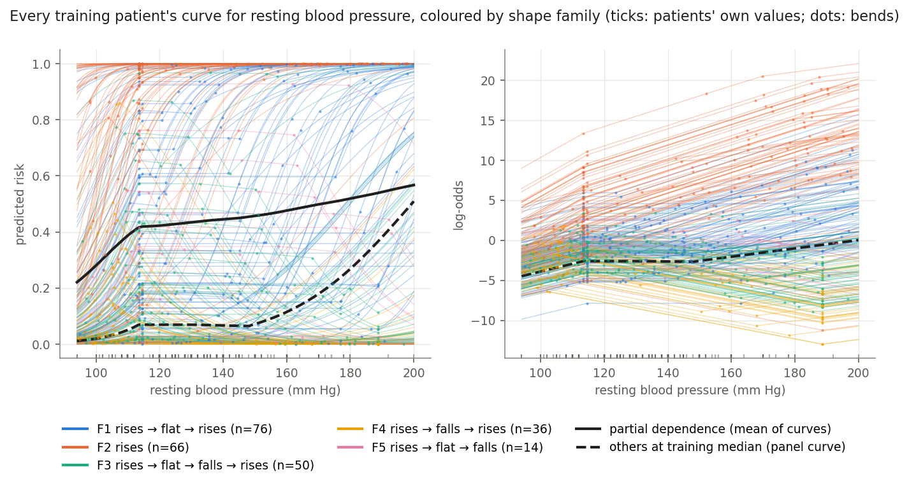
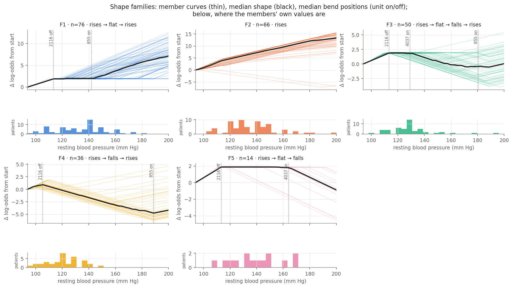
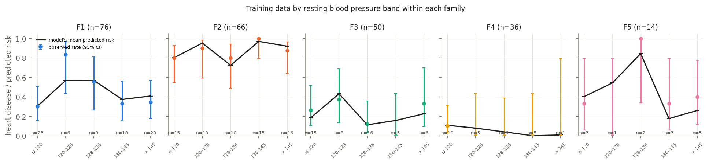
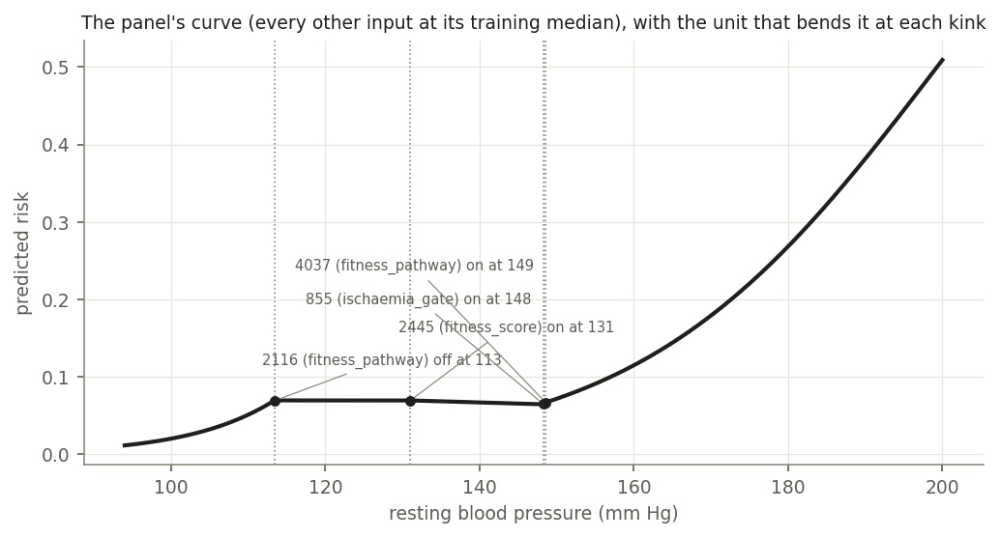
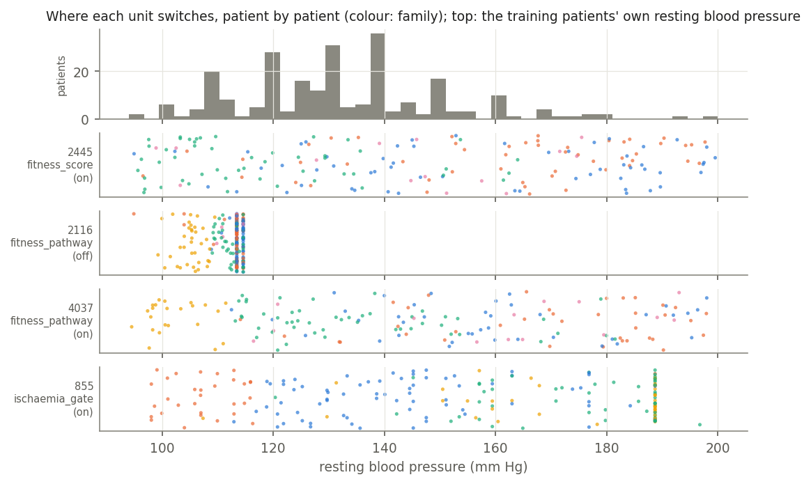

# Feature dossier: resting blood pressure (`trestbps`) in heart100-s8

Genome `b4c5f225-ec5f-4e11-996d-27d32b7d1290`, explanation `27df9ddc-3b43-4777-91cf-a282e6de32f5`, experiment 10seed-heart100-s8, split `165cebbd-6609-46ca-867e-c09e17b2d6ec`. Training split (242 patients) for everything; test numbers (61 patients) are labelled and were never used to choose anything. Read-only: nothing was written to the database. Built by `explaneat dossier` (schema 1.0.0).

This describes **what the model does** with this input. It is not a claim about blood pressure and heart disease in the world.

## Reading (hand-written, Claude, 2026-11-18; draft for Mike's review)

**In one paragraph.** Resting blood pressure reaches the output through three switches, and each patient's
curve is those three switches in some order. (1) *A low-pressure discount* (unit 2116, fitness_pathway):
below about 113–115 mm Hg the model lowers the risk, less and less as pressure rises, so **every**
patient's risk rises from 94 up to about 113 mm Hg. (2) *The ischaemia gate* (unit 855, ischaemia_gate):
above a patient-specific pressure the risk **rises steeply** (+0.13 log-odds per mm Hg). The gate opens
earlier with a reversible thallium defect, ST depression, high fasting sugar or exercise angina. It opens
later with an upsloping ST segment, and typical angina moves it 113 mm Hg higher, which for most patients puts it beyond the observed range. (3) *The
fitness readout* (unit 4037 via the fitness score 2445, fitness_pathway): above another patient-specific
pressure the risk **falls** (−0.07 log-odds per mm Hg). That pressure is lower for younger patients,
patients with a high peak heart rate and patients without exercise angina. The "strange" shapes are
which of (2) and (3) comes first and whether it falls inside 94–200 mm Hg.

**The families (the model, not the world):**

- **F1, 76 patients: rises, levels off, rises again.** The discount ends at about 113. Then the curve is flat
  until the gate opens (median 142 mm Hg, but anywhere from 121 to 177), and after that it climbs. For the
  typical member the risk is 5% at 94, 25% from 113 to 142 and 94% at 200 mm Hg. Older patients without a
  reversible defect are the clearest members (age > 65.5 and no reversible defect: 20 of 20). The family is
  the "default" shape, though, and the tree describes it only loosely (balanced accuracy 0.75).
- **F2, 66 patients: rises all the way.** The gate is open from low pressure (median 107 mm Hg, or open
  over the whole range), so every bend is a change of steepness, never a change of direction. Typical
  member: 56% at 94 rising to almost certain disease. Who: a reversible thallium defect without typical
  angina or an upsloping ST segment (47 of 53), or ST depression > 2 mm.
- **F3, 50 patients: rises, flat, falls, then rises again at the very top.** Here the fitness readout
  switches on before the gate (median 129 mm Hg). From there the risk falls until the gate opens at
  about 180 mm Hg (typical member: 10% at 129 falls to 0.9% at 180, then 4% at 200). Who: middle-aged
  (45–63) with little ST depression (< 0.8 mm). This captures 41 of 50, but the rule also takes in 36
  patients from other families.
- **F4, 36 patients: a short rise, then a long fall.** The fitness readout is on from about 100 mm Hg and
  the discount ends at about 105, so the risk falls from 105 to 189 mm Hg (typical member 13% to under
  0.1%). The gate opens only at 189 mm Hg, where the formula's constant plus the upsloping-ST term puts
  it for patients with no other gate inputs (159.4 + 29.3 = 188.7). Who: younger than 44.5 with no
  exercise angina (30 of 33).
- **F5, 14 patients: rises, flat, falls.** Typical angina keeps the gate shut in the observed range (it
  adds 113 mm Hg to the gate's threshold), so after the flat stretch only the fitness readout acts: the risk falls above about
  164 mm Hg. Who: typical angina, younger than 63.5, peak heart rate below 174.5 (10 of 11). The family is
  small.

**Where the shapes rest on little data.** Only 13 of the 242 training patients have a resting BP above
160 mm Hg and only 2 above 180. Only 41 are below 113 mm Hg. So:

- The first rise (94 to 113 mm Hg) is common to every patient but sits where 41 patients are. It agrees
  in direction with the crude data: 34% disease below 113 mm Hg against 42–48% from 113 to 160.
- The long falls of F3, F4 and F5, and the late rises at 180–200 mm Hg, lie mostly where there are almost
  no patients. In F4 only 1 member is near the 189 mm Hg bend (flagged thin); 30 of its 36 members sit on
  the falling stretch, but almost all of them between 105 and 145 mm Hg. F5's fall above 164 mm Hg holds
  2 of its 14 members.
- Within families the observed rates are too small to show or refute a bend. F4 has 2 of 19 with disease
  at ≤ 120 mm Hg and 0 of 17 above, which neither contradicts the falling curve nor supports it. F3's
  rates jump about (27%, 38%, 12%, 0%, 33% across the five bands). The model's mean predicted risk tracks
  the observed rates band by band in every family, but its curves hold the patient fixed and the band
  rates do not.
- The model's claim that higher blood pressure *lowers* the risk for younger, fitter patients (F3, F4, F5:
  100 patients, 41%) runs against clinical expectation. The v4 record already flags it as "worth
  checking". The dossier shows where that claim comes from (unit 4037 and its threshold formula) and that it
  is a statement about 130–200 mm Hg, where the data is thin.

**The panel's curve.** The line plot Mike was looking at (others at the training median) is rises → flat
→ (a 0.005 log-odds/mm Hg dip from 2445 at 131) → rises steeply after 148 mm Hg. There the gate (855 on at
148.3) and the fitness readout (4037 on at 148.6) switch almost together, and the gate's +0.128 beats the
readout's −0.071. That curve is for a patient with *no* chest-pain type, *no* resting-ECG category and
*no* ST slope (the median of each one-hot column is 0), so no real patient has this curve. The families are the shapes real patients have.

**Unresolved.** The trees are readable approximations (the multi-class tree is 63% accurate on training and
59% in cross-validation). Exact membership is set by the threshold formulas in the units table, and those
are linear in age, peak heart rate, ST depression and the flags. A two-variable picture (age against peak
heart rate, coloured by family) would probably describe F3/F4 better than any axis-aligned tree.

## The families, in plain words

Each training patient's curve is the model's predicted risk as resting blood pressure moves over its observed training range (94–200 mm Hg) with everything else about the patient kept. The curves fall into 5 families by their shape:

| family | n | shape | who (first rule) |
|---|---|---|---|
| F1 | 76 | rises → flat → rises | age > 65.5 years and thallium stress test result ≠ a reversible defect on the thallium scan |
| F2 | 66 | rises | chest pain type ≠ typical angina and slope of the ST segment at peak exercise ≠ an upsloping ST segment and thallium stress test result = a reversible defect on the thallium scan |
| F3 | 50 | rises → flat → falls → rises | age < 63.5 years and age > 45.5 years and ST depression during exercise (compared with rest) < 0.8 mm |
| F4 | 36 | rises → falls → rises | age < 44.5 years and exercise-induced angina = no chest pain on exercise |
| F5 | 14 | rises → flat → falls | age < 63.5 years and chest pain type = typical angina and maximum heart rate reached during the exercise test < 174.5 beats per minute |

### F1: rises → flat → rises (76 patients, 31% of training)

**Who.** age > 65.5 years and thallium stress test result ≠ a reversible defect on the thallium scan (20 of the 20 patients this describes are in the family, 26% of the family); or age < 65.5 years and age > 63.5 years and thallium stress test result ≠ a reversible defect on the thallium scan (8 of the 10 patients this describes are in the family, 10% of the family). (One-vs-rest tree, balanced accuracy 0.751 on training.)

**Shape (the model).** rises from about 94 to 113 mm Hg (+1.88 log-odds, typical member 5% → 25%); it ends where unit 2116 (fitness_pathway) switches off (71 of 72); smaller bends inside: 2445 (fitness_score) on (4), 2116 (fitness_pathway) off (1); 13 members have their own value on this piece; then flat from about 113 to 142 mm Hg (+0.00 log-odds, typical member 25% → 25%); it ends where unit 855 (ischaemia_gate) switches on (65 of 72); smaller bends inside: 2445 (fitness_score) on (15), 855 (ischaemia_gate) on (7), 4037 (fitness_pathway) on (6); 34 members have their own value on this piece; then rises from about 142 to 200 mm Hg (+5.33 log-odds, typical member 25% → 94%); smaller bends inside: 2445 (fitness_score) on (35), 4037 (fitness_pathway) on (28); 25 members have their own value on this piece.

Rare shapes merged in: up → flat (n=4).

**Data support.** 2116 (fitness_pathway) off at 113 mm Hg (10–90%: 113–115; 9 family members and 28 training patients have a value there); 855 (ischaemia_gate) on at 142 mm Hg (10–90%: 121–177; 61 family members and 198 training patients have a value there); 2445 (fitness_score) on at 153 mm Hg (10–90%: 120–191; 61 family members and 200 training patients have a value there); 4037 (fitness_pathway) on at 158 mm Hg (10–90%: 132–192; 49 family members and 147 training patients have a value there).

**Typical member** (the patient whose curve is closest to the family median): age: 51 years; sex: male; chest pain type: non-anginal chest pain; serum cholesterol: 227 mg/dL (5.9 mmol/L); fasting blood sugar: fasting blood sugar of 120 mg/dL or less; resting ECG: a normal resting ECG; maximum heart rate reached during the exercise test: 154 beats per minute; exercise-induced angina: chest pain brought on by exercise; ST depression during exercise (compared with rest): 0.0 mm; slope of the ST segment at peak exercise: an upsloping ST segment; number of major vessels coloured by fluoroscopy: 1 vessels; thallium stress test result: a reversible defect on the thallium scan.

| resting blood pressure band | train n | disease | observed rate (95% CI) | model mean risk | test n | test rate | test model risk |
|---|---|---|---|---|---|---|---|
| ≤ 120 | 23 | 7 | 30% (16%–51%) | 31% | 5 | 60% | 60% |
| 120–128 | 6 | 5 | 83% (44%–97%) | 57% | 1 | 0% | 2% |
| 128–136 | 9 | 5 | 56% (27%–81%) | 57% | 2 | 0% | 47% |
| 136–145 | 18 | 6 | 33% (16%–56%) | 38% | 0 | – | – |
| > 145 | 20 | 7 | 35% (18%–57%) | 41% | 2 | 50% | 52% |

Below / above each main bend (training, members' own values): 2116 (fitness_pathway) off at 113: below 5/15 (33%, model 34%), above 25/61 (41%, model 42%); 855 (ischaemia_gate) on at 142: below 22/53 (42%, model 40%), above 8/23 (35%, model 42%); 2445 (fitness_score) on at 153: below 26/65 (40%, model 39%), above 4/11 (36%, model 46%); 4037 (fitness_pathway) on at 158: below 26/67 (39%, model 38%), above 4/9 (44%, model 54%).

### F2: rises (66 patients, 27% of training)

**Who.** chest pain type ≠ typical angina and slope of the ST segment at peak exercise ≠ an upsloping ST segment and thallium stress test result = a reversible defect on the thallium scan (47 of the 53 patients this describes are in the family, 71% of the family); or ST depression during exercise (compared with rest) > 2.0 mm and slope of the ST segment at peak exercise ≠ an upsloping ST segment and thallium stress test result ≠ a reversible defect on the thallium scan (10 of the 15 patients this describes are in the family, 15% of the family). (One-vs-rest tree, balanced accuracy 0.922 on training.)

**Shape (the model).** rises from about 94 to 200 mm Hg (+13.50 log-odds, typical member 56% → >99.9%); smaller bends inside: 2116 (fitness_pathway) off (64), 2445 (fitness_score) on (50), 4037 (fitness_pathway) on (37), 855 (ischaemia_gate) on (31); 64 members have their own value on this piece.

Rare shapes merged in: down → up (n=1), up → down (n=1).

**Data support.** 855 (ischaemia_gate) on at 107 mm Hg (10–90%: 99–116; 15 family members and 75 training patients have a value there); 2116 (fitness_pathway) off at 113 mm Hg (10–90%: 113–115; 5 family members and 28 training patients have a value there); 2445 (fitness_score) on at 167 mm Hg (10–90%: 125–191; 58 family members and 194 training patients have a value there); 4037 (fitness_pathway) on at 178 mm Hg (10–90%: 138–191; 31 family members and 104 training patients have a value there).

**Typical member** (the patient whose curve is closest to the family median): age: 63 years; sex: male; chest pain type: no chest pain (asymptomatic); serum cholesterol: 254 mg/dL (6.6 mmol/L); fasting blood sugar: fasting blood sugar of 120 mg/dL or less; resting ECG: signs of left ventricular hypertrophy on the resting ECG; maximum heart rate reached during the exercise test: 147 beats per minute; exercise-induced angina: no chest pain on exercise; ST depression during exercise (compared with rest): 1.4 mm; slope of the ST segment at peak exercise: a flat ST segment; number of major vessels coloured by fluoroscopy: 1 vessels; thallium stress test result: a reversible defect on the thallium scan.

| resting blood pressure band | train n | disease | observed rate (95% CI) | model mean risk | test n | test rate | test model risk |
|---|---|---|---|---|---|---|---|
| ≤ 120 | 15 | 12 | 80% (55%–93%) | 80% | 7 | 71% | 77% |
| 120–128 | 10 | 9 | 90% (60%–98%) | 95% | 4 | 75% | 86% |
| 128–136 | 10 | 8 | 80% (49%–94%) | 72% | 8 | 88% | 99.2% |
| 136–145 | 15 | 15 | 100% (80%–100%) | 97% | 3 | 100% | 99.8% |
| > 145 | 16 | 14 | 88% (64%–96%) | 92% | 4 | 100% | >99.9% |

Below / above each main bend (training, members' own values): 855 (ischaemia_gate) on at 107: below 0/2 (0%, model 24%), above 58/64 (91%, model 90%); 2116 (fitness_pathway) off at 113: below 4/6 (67%, model 73%), above 54/60 (90%, model 90%); 2445 (fitness_score) on at 167: below 53/61 (87%, model 87%), above 5/5 (100%, model >99.9%); 4037 (fitness_pathway) on at 178: below 56/64 (88%, model 88%), above 2/2 (100%, model >99.9%).

### F3: rises → flat → falls → rises (50 patients, 21% of training)

**Who.** age < 63.5 years and age > 45.5 years and ST depression during exercise (compared with rest) < 0.8 mm (41 of the 77 patients this describes are in the family, 82% of the family). (One-vs-rest tree, balanced accuracy 0.845 on training.)

**Shape (the model).** rises from about 94 to 113 mm Hg (+1.88 log-odds, typical member 2% → 11%); it ends where unit 2116 (fitness_pathway) switches off (46 of 50); smaller bends inside: 2445 (fitness_score) on (26), 2116 (fitness_pathway) off (4); 7 members have their own value on this piece; then flat from about 113 to 129 mm Hg (-0.07 log-odds, typical member 11% → 10%); it ends where unit 4037 (fitness_pathway) switches on (50 of 50); smaller bends inside: 2445 (fitness_score) on (20); 21 members have their own value on this piece; then falls from about 129 to 180 mm Hg (-3.11 log-odds, typical member 10% → 0.9%); it ends where unit 855 (ischaemia_gate) switches on (50 of 50); 19 members have their own value on this piece; then rises from about 180 to 200 mm Hg (+1.01 log-odds, typical member 0.9% → 4%); 3 members have their own value on this piece.

**Data support.** 2445 (fitness_score) on at 112 mm Hg (10–90%: 98–151; 47 family members and 218 training patients have a value there); 2116 (fitness_pathway) off at 113 mm Hg (10–90%: 110–115; 8 family members and 38 training patients have a value there); 4037 (fitness_pathway) on at 129 mm Hg (10–90%: 115–168; 44 family members and 216 training patients have a value there); 855 (ischaemia_gate) on at 180 mm Hg (10–90%: 157–189; 5 family members and 28 training patients have a value there).

**Typical member** (the patient whose curve is closest to the family median): age: 55 years; sex: female; chest pain type: atypical angina; serum cholesterol: 342 mg/dL (8.8 mmol/L); fasting blood sugar: fasting blood sugar of 120 mg/dL or less; resting ECG: a normal resting ECG; maximum heart rate reached during the exercise test: 166 beats per minute; exercise-induced angina: no chest pain on exercise; ST depression during exercise (compared with rest): 1.2 mm; slope of the ST segment at peak exercise: an upsloping ST segment; number of major vessels coloured by fluoroscopy: 0 vessels; thallium stress test result: a normal thallium scan.

| resting blood pressure band | train n | disease | observed rate (95% CI) | model mean risk | test n | test rate | test model risk |
|---|---|---|---|---|---|---|---|
| ≤ 120 | 15 | 4 | 27% (11%–52%) | 19% | 5 | 20% | 20% |
| 120–128 | 8 | 3 | 38% (14%–69%) | 43% | 1 | 100% | 36% |
| 128–136 | 16 | 2 | 12% (4%–36%) | 12% | 2 | 0% | 24% |
| 136–145 | 5 | 0 | 0% (0%–43%) | 16% | 4 | 0% | 19% |
| > 145 | 6 | 2 | 33% (10%–70%) | 23% | 1 | 100% | 14% |

Below / above each main bend (training, members' own values): 2445 (fitness_score) on at 112: below 1/5 (20%, model 10%), above 10/45 (22%, model 22%); 2116 (fitness_pathway) off at 113: below 2/9 (22%, model 16%), above 9/41 (22%, model 22%); 4037 (fitness_pathway) on at 129: below 7/24 (29%, model 26%), above 4/26 (15%, model 15%); 855 (ischaemia_gate) on at 180: below 10/49 (20%, model 20%), above 1/1 (100%, model 67%).

### F4: rises → falls → rises (36 patients, 15% of training)

**Who.** age < 44.5 years and exercise-induced angina = no chest pain on exercise (30 of the 33 patients this describes are in the family, 83% of the family). (One-vs-rest tree, balanced accuracy 0.968 on training.)

**Shape (the model).** rises from about 94 to 105 mm Hg (+0.90 log-odds, typical member 5% → 13%); it ends where unit 2116 (fitness_pathway) switches off (32 of 36); smaller bends inside: 4037 (fitness_pathway) on (19), 2116 (fitness_pathway) off (4); 4 members have their own value on this piece; then falls from about 105 to 189 mm Hg (-6.17 log-odds, typical member 13% → <0.1%); it ends where unit 855 (ischaemia_gate) switches on (36 of 36); 30 members have their own value on this piece; then rises from about 189 to 200 mm Hg (+0.59 log-odds, typical member <0.1% → <0.1%); 2 members have their own value on this piece.

**Data support.** 4037 (fitness_pathway) on at 100 mm Hg (10–90%: 98–110; 11 family members and 42 training patients have a value there); 2116 (fitness_pathway) off at 105 mm Hg (10–90%: 102–108; 9 family members and 39 training patients have a value there); 855 (ischaemia_gate) on at 189 mm Hg (10–90%: 150–189; 1 family members and 47 training patients have a value there; **thin**).
Flag: 855 (ischaemia_gate) on sits where fewer than 5 of this family's patients have their values: that part of the shape is the model extrapolating within the observed range, not something the family's data shows.

**Typical member** (the patient whose curve is closest to the family median): age: 44 years; sex: male; chest pain type: atypical angina; serum cholesterol: 220 mg/dL (5.7 mmol/L); fasting blood sugar: fasting blood sugar of 120 mg/dL or less; resting ECG: a normal resting ECG; maximum heart rate reached during the exercise test: 170 beats per minute; exercise-induced angina: no chest pain on exercise; ST depression during exercise (compared with rest): 0.0 mm; slope of the ST segment at peak exercise: an upsloping ST segment; number of major vessels coloured by fluoroscopy: 0 vessels; thallium stress test result: a normal thallium scan.

| resting blood pressure band | train n | disease | observed rate (95% CI) | model mean risk | test n | test rate | test model risk |
|---|---|---|---|---|---|---|---|
| ≤ 120 | 19 | 2 | 10% (3%–31%) | 11% | 5 | 40% | 22% |
| 120–128 | 5 | 0 | 0% (0%–43%) | 8% | 1 | 0% | 0.4% |
| 128–136 | 6 | 0 | 0% (0%–39%) | 4% | 4 | 0% | 6% |
| 136–145 | 5 | 0 | 0% (0%–43%) | 0.4% | 1 | 0% | 0.7% |
| > 145 | 1 | 0 | 0% (0%–79%) | 1% | 1 | 100% | 0.3% |

Below / above each main bend (training, members' own values): 4037 (fitness_pathway) on at 100: below 0/1 (0%, model 0.1%), above 2/35 (6%, model 8%); 2116 (fitness_pathway) off at 105: below 0/5 (0%, model 3%), above 2/31 (6%, model 8%); 855 (ischaemia_gate) on at 189: below 2/36 (6%, model 8%), above 0/0 (–, model –).

### F5: rises → flat → falls (14 patients, 6% of training)

**Who.** age < 63.5 years and chest pain type = typical angina and maximum heart rate reached during the exercise test < 174.5 beats per minute (10 of the 11 patients this describes are in the family, 71% of the family). (One-vs-rest tree, balanced accuracy 0.982 on training.)

**Shape (the model).** rises from about 94 to 113 mm Hg (+1.88 log-odds, typical member 8% → 35%); it ends where unit 2116 (fitness_pathway) switches off (14 of 14); smaller bends inside: 2445 (fitness_score) on (3); 0 members have their own value on this piece; then flat from about 113 to 164 mm Hg (-0.08 log-odds, typical member 35% → 33%); it ends where unit 4037 (fitness_pathway) switches on (14 of 14); smaller bends inside: 2445 (fitness_score) on (11); 12 members have their own value on this piece; then falls from about 164 to 200 mm Hg (-2.73 log-odds, typical member 33% → 7%); 2 members have their own value on this piece.

**Data support.** 2116 (fitness_pathway) off at 113 mm Hg (10–90%: 111–114; 2 family members and 35 training patients have a value there; **thin**); 2445 (fitness_score) on at 147 mm Hg (10–90%: 103–174; 14 family members and 236 training patients have a value there); 4037 (fitness_pathway) on at 164 mm Hg (10–90%: 120–191; 13 family members and 200 training patients have a value there).
Flag: 2116 (fitness_pathway) off sits where fewer than 5 of this family's patients have their values: that part of the shape is the model extrapolating within the observed range, not something the family's data shows.

**Typical member** (the patient whose curve is closest to the family median): age: 59 years; sex: male; chest pain type: typical angina; serum cholesterol: 273 mg/dL (7.1 mmol/L); fasting blood sugar: fasting blood sugar of 120 mg/dL or less; resting ECG: signs of left ventricular hypertrophy on the resting ECG; maximum heart rate reached during the exercise test: 125 beats per minute; exercise-induced angina: no chest pain on exercise; ST depression during exercise (compared with rest): 0.0 mm; slope of the ST segment at peak exercise: an upsloping ST segment; number of major vessels coloured by fluoroscopy: 0 vessels; thallium stress test result: a normal thallium scan.

| resting blood pressure band | train n | disease | observed rate (95% CI) | model mean risk | test n | test rate | test model risk |
|---|---|---|---|---|---|---|---|
| ≤ 120 | 3 | 1 | 33% (6%–79%) | 40% | 0 | – | – |
| 120–128 | 1 | 0 | 0% (0%–79%) | 55% | 0 | – | – |
| 128–136 | 2 | 2 | 100% (34%–100%) | 84% | 0 | – | – |
| 136–145 | 3 | 1 | 33% (6%–79%) | 18% | 0 | – | – |
| > 145 | 5 | 2 | 40% (12%–77%) | 26% | 0 | – | – |

Below / above each main bend (training, members' own values): 2116 (fitness_pathway) off at 113: below 1/1 (100%, model 55%), above 5/13 (38%, model 36%); 2445 (fitness_score) on at 147: below 4/9 (44%, model 44%), above 2/5 (40%, model 26%); 4037 (fitness_pathway) on at 164: below 5/12 (42%, model 36%), above 1/2 (50%, model 46%).

The observed rates mix everything else that differs between bands; the model's curves hold the rest of the patient fixed. Agreement or disagreement here is a check on whether the data could show the bend, not a test of it.

## The panel's curve

Every other column at its training median, as in the evidence panel's line plot. Each kink is one hidden unit switching:

| at (mm Hg) | unit (part) | switches | change of slope (log-odds per mm Hg) | risk there |
|---|---|---|---|---|
| 113.4 | 2116 (fitness_pathway) | off | -0.0966 | 7% |
| 131.0 | 2445 (fitness_score) | on | -0.0047 | 7% |
| 148.3 | 855 (ischaemia_gate) | on | +0.1281 | 6% |
| 148.6 | 4037 (fitness_pathway) | on | -0.0714 | 7% |

Held values: age: 56 years; sex: male; chest pain type: none; serum cholesterol: 240 mg/dL (6.2 mmol/L); fasting blood sugar: fasting blood sugar of 120 mg/dL or less; resting ECG: none; maximum heart rate reached during the exercise test: 152 beats per minute; exercise-induced angina: no chest pain on exercise; ST depression during exercise (compared with rest): 0.8 mm; slope of the ST segment at peak exercise: none; number of major vessels coloured by fluoroscopy: 0 vessels; thallium stress test result: a normal thallium scan.

Note: the training median of a one-hot column is 0 unless one level holds more than half the patients, so on this curve the categories marked 'none' have **no level at all** (all their columns 0). The panel's curve is for a patient who does not exist; the families above are the curves of real patients.

## Units the input reaches

Copies of `trestbps` varied: -8_a, -8_b, -8_c. A unit's threshold is where its pre-activation is zero; it depends on the patient's other inputs, and the formula changes with the on/off state of the units upstream of it. Formulas are in real units; [x = level] is 1 when true, 0 otherwise.

| unit | part (explanation's name) | reached | switches in range | on throughout | off throughout | threshold 10–50–90% | bend (log-odds over the range) |
|---|---|---|---|---|---|---|---|
| 2445 | fitness_score | -8_c (w 1.51) | 171 (on) | 39 | 32 | 103–145–187 | -0.50 |
| 4835 | fitness_pathway | –; via 2445 | 0 (on) | 242 | 0 | – | – |
| 2116 | fitness_pathway | -8_b (w -2.651); via 4835 | 242 (off) | 0 | 0 | 106–113–115 | -10.24 |
| 4037 | fitness_pathway | –; via 2445 | 163 (on) | 16 | 63 | 106–145–188 | -7.57 |
| 855 | ischaemia_gate | -8_a (w 1.111) | 190 (on) | 33 | 19 | 109–154–189 | +13.58 |

**Unit 2445** (fitness_score: "Node 2445 ≈ relu(−2.13·age + 1.3·exang:0 + 1.51·trestbps − 1.12·relu(0.675 − 0.573·thalach) − 2.14·relu(1.01·age + 0.189) + 0.827), in z-units, not raw units (off by up to 0.016 on the training rows).")

- 109 crossings when 9765 on (age > 53.1 years); 5869 on (maximum heart rate reached during the exercise test < 176.5 beats per minute): `resting blood pressure* = -100.6 − 33.0·[exercise-induced angina = no chest pain on exercise] + 5.66·age − 0.344·maximum heart rate reached during the exercise test  (mm Hg)`; the unit is on above the threshold (formula vs located crossings: max error 1.14e-13).
- 53 crossings when 9765 off (age < 53.1 years); 5869 on (maximum heart rate reached during the exercise test < 176.5 beats per minute): `resting blood pressure* = 50.82 − 33.0·[exercise-induced angina = no chest pain on exercise] + 2.81·age − 0.344·maximum heart rate reached during the exercise test  (mm Hg)`; the unit is on above the threshold (formula vs located crossings: max error 5.68e-14).
- 7 crossings when 9765 off (age < 53.1 years); 5869 off (maximum heart rate reached during the exercise test > 176.5 beats per minute): `resting blood pressure* = -9.974 − 33.0·[exercise-induced angina = no chest pain on exercise] + 2.81·age  (mm Hg)`; the unit is on above the threshold (formula vs located crossings: max error 2.84e-14).
- 2 crossings when 9765 on (age > 53.1 years); 5869 off (maximum heart rate reached during the exercise test > 176.5 beats per minute): `resting blood pressure* = -161.4 − 33.0·[exercise-induced angina = no chest pain on exercise] + 5.66·age  (mm Hg)`; the unit is on above the threshold (formula vs located crossings: max error 2.84e-14).

**Unit 2116** (fitness_pathway: "Hypothesis: a serial readout of the fitness score S (child fitness_score) that lowers the predicted risk for young, exercise-tolerant patients and, separately, for patients with a low resting blood pressure when S is small.")

- 141 crossings when 9765 on (age > 53.1 years); 5869 on (maximum heart rate reached during the exercise test < 176.5 beats per minute); 2445 off (-8.361 − 2.74·[exercise-induced angina = no chest pain on exercise] + 0.471·age − 0.0831·resting blood pressure − 0.0286·maximum heart rate reached during the exercise test > 0): `resting blood pressure* = 114.6 − 1.16·[sex = male]  (mm Hg)`; the unit is on below the threshold (formula vs located crossings: max error 1.42e-14).
- 53 crossings when 9765 off (age < 53.1 years); 5869 on (maximum heart rate reached during the exercise test < 176.5 beats per minute); 2445 on (-4.224 + 2.74·[exercise-induced angina = no chest pain on exercise] − 0.234·age + 0.0831·resting blood pressure + 0.0286·maximum heart rate reached during the exercise test > 0); 4835 on (-3.468 + 2.59·[exercise-induced angina = no chest pain on exercise] − 0.221·age + 0.0785·resting blood pressure + 0.027·maximum heart rate reached during the exercise test > 0): `resting blood pressure* = 98.81 − 8.17·[exercise-induced angina = no chest pain on exercise] − 0.873·[sex = male] + 0.696·age − 0.0852·maximum heart rate reached during the exercise test  (mm Hg)`; the unit is on below the threshold (formula vs located crossings: max error 2.84e-14).
- 24 crossings when 9765 off (age < 53.1 years); 5869 on (maximum heart rate reached during the exercise test < 176.5 beats per minute); 2445 off (4.224 − 2.74·[exercise-induced angina = no chest pain on exercise] + 0.234·age − 0.0831·resting blood pressure − 0.0286·maximum heart rate reached during the exercise test > 0): `resting blood pressure* = 114.6 − 1.16·[sex = male]  (mm Hg)`; the unit is on below the threshold (formula vs located crossings: max error 1.42e-14).
- 20 crossings when 9765 off (age < 53.1 years); 5869 off (maximum heart rate reached during the exercise test > 176.5 beats per minute); 2445 on (0.8289 + 2.74·[exercise-induced angina = no chest pain on exercise] − 0.234·age + 0.0831·resting blood pressure > 0); 4835 on (1.303 + 2.59·[exercise-induced angina = no chest pain on exercise] − 0.221·age + 0.0785·resting blood pressure > 0): `resting blood pressure* = 83.76 − 8.17·[exercise-induced angina = no chest pain on exercise] − 0.873·[sex = male] + 0.696·age  (mm Hg)`; the unit is on below the threshold (formula vs located crossings: max error 2.84e-14).
- 2 crossings when 9765 off (age < 53.1 years); 5869 off (maximum heart rate reached during the exercise test > 176.5 beats per minute); 2445 off (-0.8289 − 2.74·[exercise-induced angina = no chest pain on exercise] + 0.234·age − 0.0831·resting blood pressure > 0): `resting blood pressure* = 114.6 − 1.16·[sex = male]  (mm Hg)`; the unit is on below the threshold (formula vs located crossings: max error 1.42e-14).
- 1 crossings when 9765 on (age > 53.1 years); 5869 off (maximum heart rate reached during the exercise test > 176.5 beats per minute); 2445 off (-13.41 − 2.74·[exercise-induced angina = no chest pain on exercise] + 0.471·age − 0.0831·resting blood pressure > 0): `resting blood pressure* = 114.6 − 1.16·[sex = male]  (mm Hg)`; the unit is on below the threshold (formula vs located crossings: max error 0.0).
- 1 crossings when 9765 on (age > 53.1 years); 5869 off (maximum heart rate reached during the exercise test > 176.5 beats per minute); 2445 on (13.41 + 2.74·[exercise-induced angina = no chest pain on exercise] − 0.471·age + 0.0831·resting blood pressure > 0); 4835 on (13.19 + 2.59·[exercise-induced angina = no chest pain on exercise] − 0.444·age + 0.0785·resting blood pressure > 0): `resting blood pressure* = 46.29 − 8.17·[exercise-induced angina = no chest pain on exercise] + 1.4·age − 0.873·[sex = male]  (mm Hg)`; the unit is on below the threshold (formula vs located crossings: max error 0.0).

**Unit 4037** (fitness_pathway: "Hypothesis: a serial readout of the fitness score S (child fitness_score) that lowers the predicted risk for young, exercise-tolerant patients and, separately, for patients with a low resting blood pressure when S is small.")

- 78 crossings when 9765 on (age > 53.1 years); 5869 on (maximum heart rate reached during the exercise test < 176.5 beats per minute); 2445 on (8.361 + 2.74·[exercise-induced angina = no chest pain on exercise] − 0.471·age + 0.0831·resting blood pressure + 0.0286·maximum heart rate reached during the exercise test > 0): `resting blood pressure* = -83.07 − 33.0·[exercise-induced angina = no chest pain on exercise] + 5.66·age − 0.344·maximum heart rate reached during the exercise test  (mm Hg)`; the unit is on above the threshold (formula vs located crossings: max error 1.14e-13).
- 71 crossings when 9765 off (age < 53.1 years); 5869 on (maximum heart rate reached during the exercise test < 176.5 beats per minute); 2445 on (-4.224 + 2.74·[exercise-induced angina = no chest pain on exercise] − 0.234·age + 0.0831·resting blood pressure + 0.0286·maximum heart rate reached during the exercise test > 0): `resting blood pressure* = 68.35 − 33.0·[exercise-induced angina = no chest pain on exercise] + 2.81·age − 0.344·maximum heart rate reached during the exercise test  (mm Hg)`; the unit is on above the threshold (formula vs located crossings: max error 5.68e-14).
- 12 crossings when 9765 off (age < 53.1 years); 5869 off (maximum heart rate reached during the exercise test > 176.5 beats per minute); 2445 on (0.8289 + 2.74·[exercise-induced angina = no chest pain on exercise] − 0.234·age + 0.0831·resting blood pressure > 0): `resting blood pressure* = 7.56 − 33.0·[exercise-induced angina = no chest pain on exercise] + 2.81·age  (mm Hg)`; the unit is on above the threshold (formula vs located crossings: max error 2.84e-14).
- 2 crossings when 9765 on (age > 53.1 years); 5869 off (maximum heart rate reached during the exercise test > 176.5 beats per minute); 2445 on (13.41 + 2.74·[exercise-induced angina = no chest pain on exercise] − 0.471·age + 0.0831·resting blood pressure > 0): `resting blood pressure* = -143.9 − 33.0·[exercise-induced angina = no chest pain on exercise] + 5.66·age  (mm Hg)`; the unit is on above the threshold (formula vs located crossings: max error 2.84e-14).

**Unit 855** (ischaemia_gate: "Node 855 ≈ relu(1.11·trestbps + 1.08·oldpeak + 0.935·thal:7 + 0.54·fbs:1 + 0.344·exang:1 − 1.98·cp:1 − 0.894·slope:1 − 1.01), in z-units, not raw units (the rounded coefficients are off by up to 0.011 on the training rows).")

- 190 crossings: `resting blood pressure* = 159.4 + 113.0·[chest pain type = typical angina] − 31.6·[thallium stress test result = a reversible defect on the thallium scan] + 29.3·[slope of the ST segment at peak exercise = an upsloping ST segment] − 25.7·[fasting blood sugar = fasting blood sugar above 120 mg/dL] − 14.9·ST depression during exercise (compared with rest) − 11.9·[exercise-induced angina = chest pain brought on by exercise]  (mm Hg)`; the unit is on above the threshold (formula vs located crossings: max error 5.68e-14).

## Method and checks

- Curves: 401 grid points over the observed training range, all copies of the input set together, through the model state (the explanation's operations replayed on the phenotype; numpy evaluator `StateEvaluator`). The panel's curve is re-run through `StructureNetwork` with `override_output_activation(model_output_activation)`: max abs difference 9.99e-16.
- Bends: 766 unit crossings located on the training curves (grid then 48 bisection steps); every kink of every curve is one of them (0 unattributed). Threshold formulas reproduce the located crossings to 1.14e-13 mm Hg.
- A bend counts for the shape if it changes the slope by at least 0.05 log-odds over the whole range; a piece reads as flat if its slope would move the log-odds less than 0.5 over the whole range; pieces shorter than 3% of the range join a neighbour. Shapes with fewer than 5 patients are merged into the nearest common shape (edit distance), at most 7 families.
- Cross-check: k-means on the curves' slope profiles (k = 5) agrees with the shape families at adjusted Rand 0.581.
- One multi-class tree for all families (decision tree, depth <= 3, leaves >= 5 patients, on the other inputs in real units (training patients)): accuracy 0.628 on training, 0.587 in 5-fold cross-validation. The per-family rules above are one-vs-rest trees. Membership is exactly determined by the unit thresholds (each a linear formula of the other inputs, above), so the trees are readable approximations.
- Test patients are assigned to families by the same shape rule from their own curves (nearest shape if theirs is not one of the families); their rates are a labelled check only.
